# 3D-RSI-InContext: A Recursive Self-Improvement Framework with In-Context Learning for 3D Scene Generation

A recursive self-improvement loop over two prompts: a **system prompt** (the generator's reusable Blender expertise) and a **user prompt** (the scene spec). From them, Claude writes a Blender script for a photorealistic house scene and saves it as a `.blend`. The scene has a kitchen, a living room, 3 bedrooms, a road in front and a garden in back.

No human edits the prompts, the scripts or the scenes. The only fixed inputs are the goal spec and a library of CC0 assets.

<p align="center">
  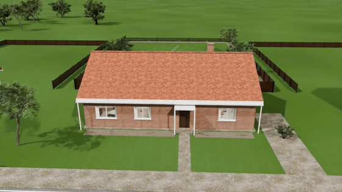
  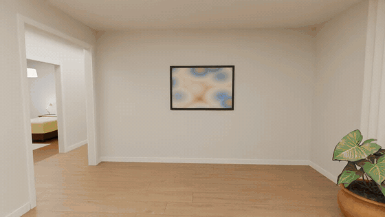
  <br><em>The best scene (iteration 5), rendered from the generated <code>.blend</code> with Cycles. Full-quality video: <a href="docs/media/flythrough.mp4"><code>docs/media/flythrough.mp4</code></a></em>
</p>

<p align="center">
  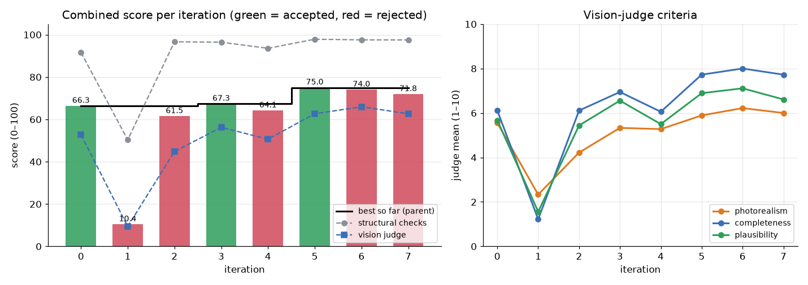
</p>

**In 7 self-improvement iterations, starting from one-line seed prompts:**
- The combined score rose from **66.3 to 75.0**.
- Structural checks rose from **91.6 to 97.8**.
- The judge's completeness score rose from **6.1 to 7.7** out of 10.
- The loop recovered from a catastrophic regression (iteration 1) and learned to stop it happening again.

## How it works

<p align="center">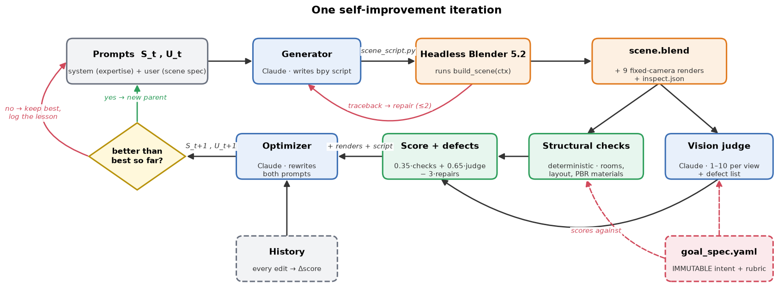</p>

<details>
<summary>Mermaid version of the diagram (for renderers that support it)</summary>

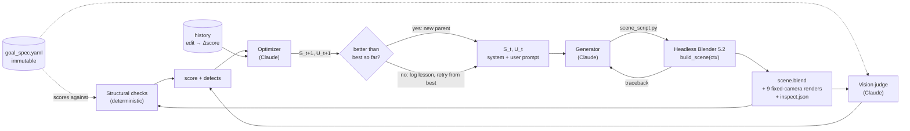

</details>

Each new iteration starts from the best-scoring prompt pair so far (elitism). A regression is logged, and its lesson is passed to the next proposal.
- **Cameras:** the harness, not the LLM, places the evaluation cameras, so every iteration is photographed from the same viewpoints.
- **Goal:** scoring always runs against the immutable `goal_spec.yaml`, never against the evolving user prompt. This stops the optimizer from improving its score by making the task easier.

## Setup

```sh
uv sync
uv run python scripts/fetch_assets.py   # one-time: ~520 MB of CC0 Poly Haven HDRIs/textures/models
```

**LLM backend** (`backend` in `config.yaml`):
- `claude_cli` (default): every role runs through headless Claude Code (`claude -p`) on your Claude subscription login. No API key is needed; log in once with `claude`. `ANTHROPIC_API_KEY` is stripped from the subprocess environment, so it can't override the login. Calls run with no tools, no MCP servers and no user settings or plugins. Images go in through `stream-json`, and structured output through `--json-schema`. Subscription usage limits apply: when one is hit, the run stops and can be resumed with `--resume`.
- `api`: the Anthropic SDK with `ANTHROPIC_API_KEY`, set in the environment or in a project `.env`.

In `usage.jsonl` and the report, costs are API-list-price equivalents. On a subscription nothing is billed per token, but `budget_usd` still caps that equivalent spend.

The Blender path is set in `config.yaml` (default: `/Applications/Blender.app/Contents/MacOS/Blender`).

## Run

```sh
uv run python -m rsi.loop --iterations 2 --samples 1 --render-samples 32   # smoke test
uv run python -m rsi.loop                                                  # full run (config.yaml)
uv run python -m rsi.loop --resume runs/<run_id> --iterations 15           # continue / extend a run
```

Each run writes `runs/<run_id>/`:
- `report.html`: score curves, the same camera across iterations, and prompt diffs with the optimizer's diagnosis
- `history.jsonl`: one record per iteration, holding prompts, per-sample scores, defects and cost
- `iter_###/system.md`, `iter_###/user.md`: the prompts for that iteration
- `iter_###/optimizer.json`: the optimizer output that produced them
- `iter_###/sample_#/scene_script.py`: the generated script
- `iter_###/sample_#/out/scene.blend`: the scene, with textures packed
- `iter_###/sample_#/out/renders/*.png`, `inspect.json`, `checks.json`, `judge.json`
- `usage.jsonl`: per-call token and USD ledger

## Files

| Path | Role |
|---|---|
| `goal_spec.yaml` | **Immutable** intent, required rooms/furniture/exterior, judge rubric and anchors, score weights. Scoring uses this, never the evolving user prompt. The loop aborts if it changes mid-run. |
| `prompts/seed_*.md` | S₀ / U₀. These are deliberately naive, so the improvement is visible. |
| `config.yaml` | Models (Claude Opus 5.5 for all roles), effort, iterations, samples per iteration, render settings, budget. |
| `rsi/generator.py` | Builds the generator call: the evolving S, then the **fixed output contract** and the asset manifest (which the optimizer cannot edit). Includes the traceback repair loop. |
| `rsi/blender_side/harness.py` | Runs inside Blender: executes `build_scene(ctx)`, inspects the scene, adds fixed cameras, packs and saves the `.blend`, and renders. |
| `rsi/blender_side/cameras.py` | Fixed evaluation cameras derived from collection bounding boxes: front street, backyard, aerial, top-down, and one per room. |
| `rsi/checks.py` | Deterministic 0–100 score covering collections present, layout (road −Y, garden +Y, room areas, overlaps), furniture/elements, and realism proxies (HDRI, textured/bumped materials, glass, bevels, interior lights). |
| `rsi/judge.py` | Claude vision judge. Gives per-view 1–10 scores for photorealism, completeness and plausibility, plus a defect list (structured output). |
| `rsi/optimizer.py` | Rewrites both prompts from the evaluation and history. A keyword guard prevents it from dropping goal requirements. |
| `rsi/loop.py` | Orchestration: samples per iteration, elitism, budget and plateau stopping, resume. |
| `rsi/report.py` | Static HTML report. |
| `scripts/make_media.py` | Builds the README media from a run: score and prompt-length charts, per-view evolution GIFs, the milestone grid, and the fly-through MP4/GIFs. |
| `scripts/make_diagram.py` | Draws the pipeline diagram (`docs/media/pipeline.png` / `.svg`) with matplotlib, so it renders in any Markdown viewer. |
| `scripts/blender_flythrough.py` | Renders an aerial orbit and a living-room pan from any generated `scene.blend`. |

**Score** = `0.35·checks + 0.65·judge − 3·repairs`. A failed sample scores 0. The iteration score is the mean over its samples, which reduces noise.

## Results: experiment `exp1`

**Settings:**
- Claude Opus 5.5 for every role, run through the `claude_cli` backend (subscription).
- 2 samples per iteration, Cycles at 128 samples, 960×540.
- Started from the naive one-line seed prompts.

The run stopped after iteration 7, when it reached the $80 API-equivalent budget cap (final total $85.50). Iteration 5 is the best. The full history is in [`docs/exp1/history_summary.json`](docs/exp1/history_summary.json).

| iter | parent | score | Δ vs best | accepted | checks (mean) | judge (mean) | photoreal / complete / plausible (1–10) | repairs | S / U chars |
|---|---|---|---|---|---|---|---|---|---|
| 0 | seed | 66.3 | — | ✔ | 91.6 | 52.7 | 5.6 / 6.1 / 5.7 | 0, 0 | 121 / 198 |
| 1 | 0 | 10.4 | −56.0 | ✘ | 50.3 / fail | 9.4 / fail | 2.3 / 1.2 / 1.6 | 1, 2 | 9.3k / 6.8k |
| 2 | 0 | 61.5 | −4.9 | ✘ | 96.6 | 44.8 | 4.2 / 6.1 / 5.4 | 1, 0 | 8.9k / 9.1k |
| 3 | 0 | 67.3 | +1.0 | ✔ | 96.4 | 56.2 | 5.3 / 6.9 / 6.6 | 1, 1 | 9.9k / 8.8k |
| 4 | 3 | 64.1 | −3.2 | ✘ | 93.5 | 50.6 | 5.3 / 6.1 / 5.5 | 1, 0 | 13.7k / 10.0k |
| **5** | 3 | **75.0** | **+7.7** | ✔ | **97.8** | 62.7 | 5.9 / 7.7 / 6.9 | 0, 0 | 13.6k / 11.8k |
| 6 | 5 | 74.0 | −1.0 | ✘ | 97.5 | **65.9** | **6.2 / 8.0 / 7.1** | 1, 1 | 15.4k / 13.0k |
| 7 | 5 | 71.8 | −3.2 | ✘ | 97.5 | 62.7 | 6.0 / 7.7 / 6.6 | 1, 1 | 15.7k / 13.5k |

**What the loop learned:**
- **Iteration 1 failed by over-specifying.** The optimizer expanded the prompts about 50×, and the generated scripts ran past the output limit or the render timeout.
- **That failure became the main lesson.** Every later proposal kept an explicit script-size budget (about 650 lines, ≤40k chars), and repairs fell to zero by iteration 5.
- **Floor plan:** an exact floor plan with dimensions pushed the structural checks from about 90 to about 98.
- **Optimizer edits to the system prompt** were Blender 5.2 API names, glass and window recipes, the lawn and fence setup, and exterior wall depth.
- **Optimizer edits to the user prompt** were the room layout, the furniture per room, the street furniture and the backyard layout.
- **Every edit cites a judge defect or check failure,** recorded in `optimizer.json`.
- **Iteration 6 had the best judge scores** but lost to iteration 5, because the repair penalty cost more than the judge gain. Elitism kept iteration 5 as the parent. Iteration 7 tried to keep iteration 6's fixes without the truncation, but both samples still needed a repair. Prompt length growth (~29k chars) is the current bottleneck.

### Same camera, every iteration

Each animation steps through iterations 0→7 from one fixed harness camera, using the best sample of each iteration. The label shows the iteration score and whether the iteration was accepted as the new parent.

| Front street | Aerial |
|---|---|
| 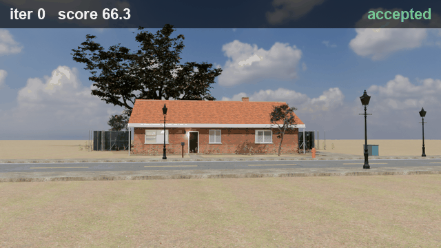 | 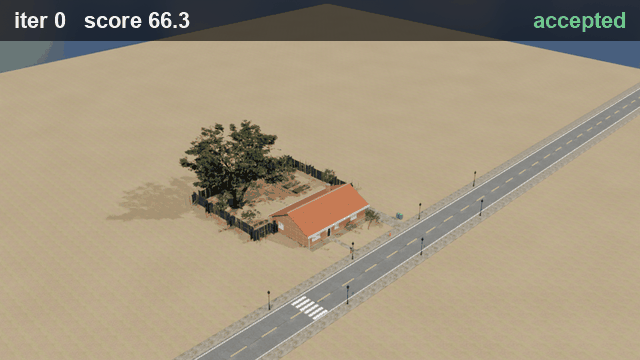 |
| **Backyard** | **Living room** |
| 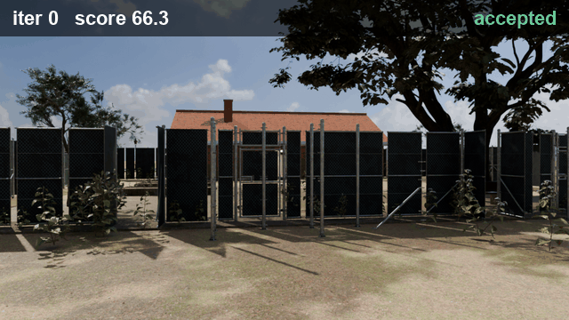 | 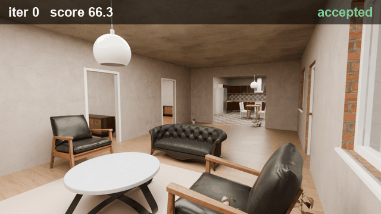 |
| **Kitchen** | **Bedroom 1** |
| 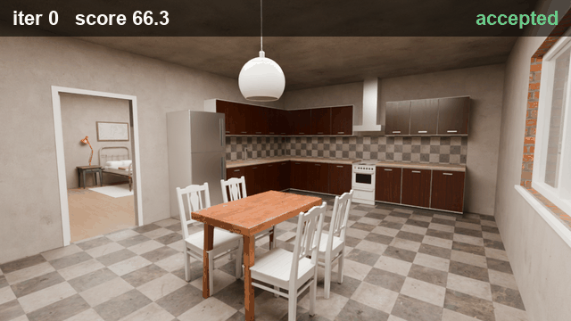 | 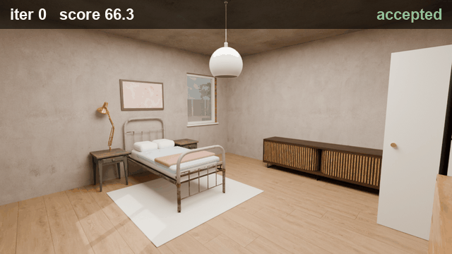 |

### Milestones side by side

The grid compares four iterations:
- **Iteration 0, the seed:** the house sits on bare sand, the backyard is a chain-link cage, and the interiors have concrete ceilings.
- **Iteration 1, the failed over-specification:** most of the scene never got built.
- **Iteration 3:** a lawn, picket fences and a neighbourhood appear, and the interiors are finished.
- **Iteration 5, the best:** a textured lawn with fenced lots, a front porch, raised beds and stepping stones, a lighter kitchen, and a bedroom with a styled headboard and artwork.

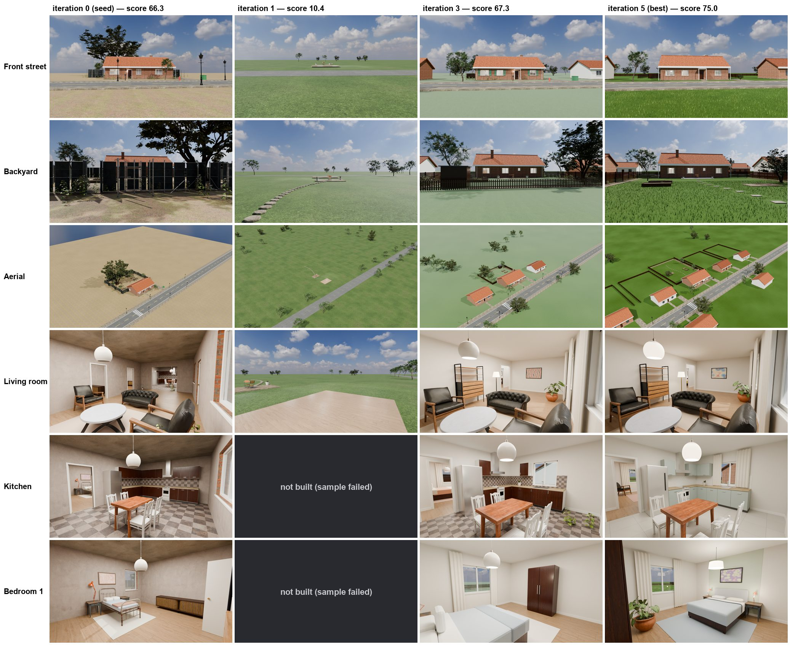

### Prompts grow from one line to dense, defect-driven specs

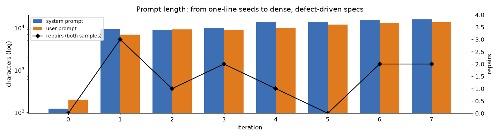

The prompts grew about 100× in the first rewrite, then kept growing slowly. Repairs fell to 0 at iteration 5, once the optimizer added a script-size budget. They rose again as the prompts kept growing, which is the current bottleneck.

**Prompt evolution.**
- The seed prompts were 121 and 198 characters: [system](docs/exp1/prompts/iter000_system.md), [user](docs/exp1/prompts/iter000_user.md).
- The best prompts, from iteration 5, are 13.6k and 11.8k characters: [system](docs/exp1/prompts/iter005_system.md), [user](docs/exp1/prompts/iter005_user.md).

**Run cost and time:**
- About 20–75 min per iteration; generation and rendering dominate.
- About $7–15 API-equivalent per iteration, not billed on the subscription.
- The `.blend` files (about 330 MB each, textures packed) and the full renders stay in `runs/`, which git ignores.

## Regenerate the README media

```sh
B=/Applications/Blender.app/Contents/MacOS/Blender
$B -b runs/exp1/iter_005/sample_1/out/scene.blend --python scripts/blender_flythrough.py -- runs/_fly 150 32
uv run python scripts/make_media.py runs/exp1 docs/media --fly runs/_fly
uv run python scripts/make_diagram.py docs/media
```

## Test the harness without the API

```sh
uv run python -c "
import yaml, json; from pathlib import Path
from rsi.blender_runner import run_scene; from rsi import checks
cfg = yaml.safe_load(open('config.yaml')); cfg['render']['samples'] = 16
r = run_scene(Path('tests/stub_scene.py'), Path('runs/_stub/out'), cfg); print(r.ok, r.error)
print(checks.score(json.load(open('runs/_stub/out/inspect.json')), yaml.safe_load(open('goal_spec.yaml'))))"
```
